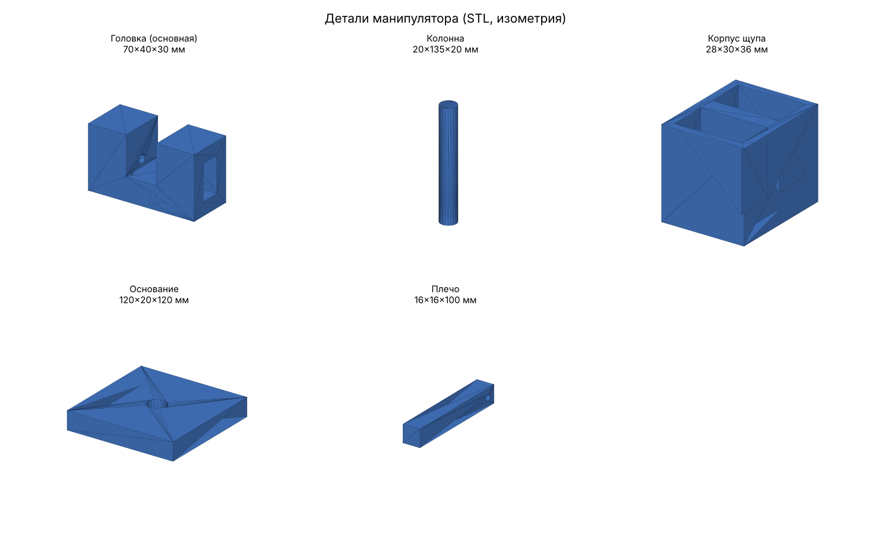
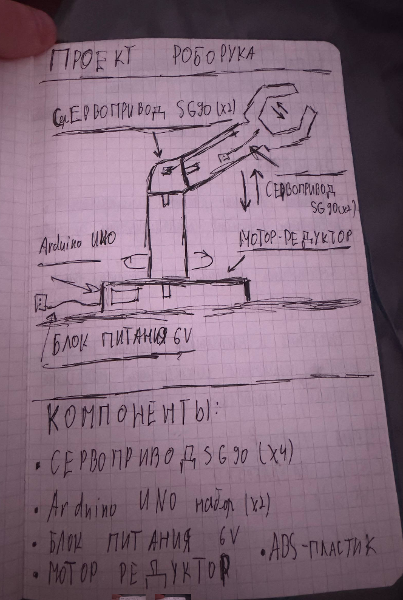
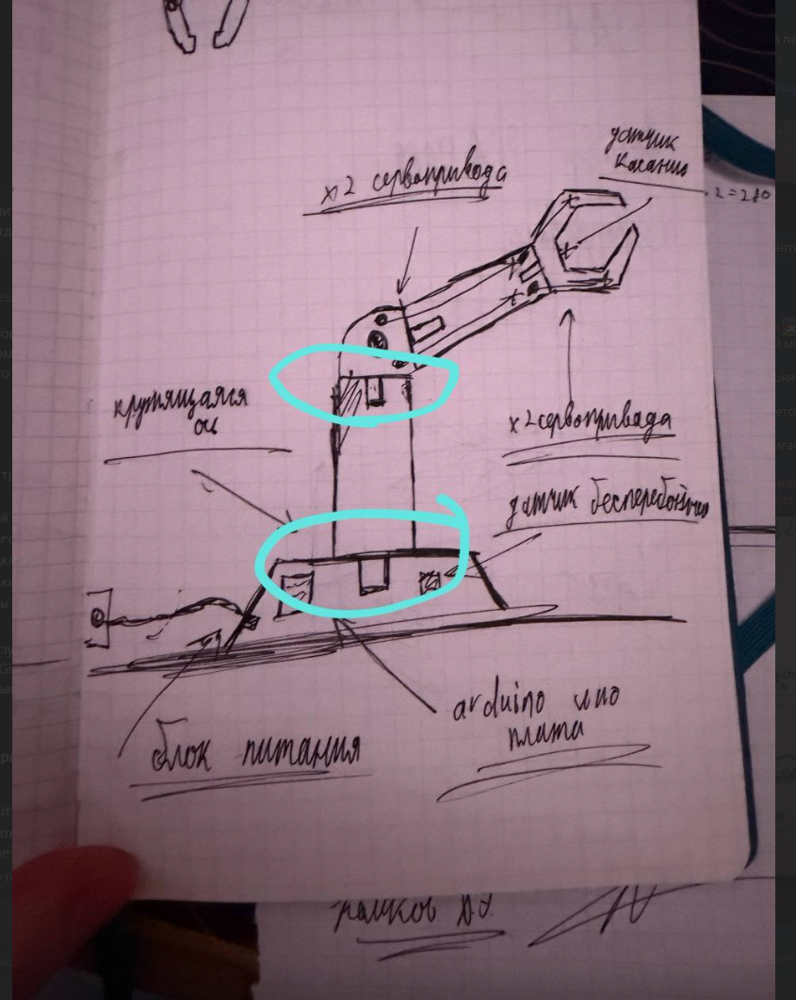
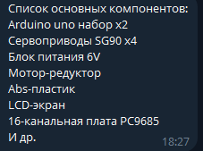

# Робо-рука: учебный манипулятор с захватом

Учебный проект: действующая модель робота-манипулятора с клешнёй (захватом) для демонстрации базовых принципов механики и управления захватом.

**Команда:** Васильев А.Ю., Комков Д.Э., Усламин К.В., Вязнин Е.А.

**Группа-** ИПР-25-1б



## Содержание

1. [Цель и задачи](#цель-и-задачи)
2. [Конструкция](#конструкция)
3. [3D-модели деталей](#3d-модели-деталей)
4. [Список компонентов](#список-компонентов)
5. [Бюджет](#бюджет)
6. [Среды разработки](#среды-разработки)
7. [Структура репозитория](#структура-репозитория)
8. [Статус и план работ](#статус-и-план-работ)

## Цель и задачи

**Цель:** создать действующую модель робота-манипулятора с клешнёй для демонстрации базовых принципов механики и управления захватом.

**Задачи:**

- Изучить принципы работы манипуляторов и захватных устройств, проанализировать существующие аналоги.
- Подготовить материалы и спроектировать 3D-модель.
- Изготовить и напечатать детали на 3D-принтере, подключить электронику, написать программу управления и собрать проект.

## Конструкция



Манипулятор состоит из неподвижного основания и вращающейся колонны с рукой и захватом:

| Узел | Привод | Количество |
| --- | --- | --- |
| Вращение колонны вокруг вертикальной оси | Мотор-редуктор | 1 |
| Сочленение руки (плечо / головка) | Сервопривод SG90 | 2 |
| Захват (клешня) | Сервопривод SG90 | 2 |

Управляющая электроника (Arduino UNO, плата PCA9685, блок питания 6 В) размещается в основании. На первом эскизе на захвате также предусмотрен датчик касания.

<details>
<summary>Первый эскиз (концепция)</summary>



</details>

## 3D-модели деталей

Файлы лежат в папке [`cad/`](cad/). GitHub умеет показывать STL прямо в браузере: откройте файл и вращайте модель мышью.

| Деталь | Файл | Габариты X × Y × Z, мм | Превью |
| --- | --- | --- | --- |
| Основание | [osnovanie.stl](cad/osnovanie.stl) | 120 × 20 × 120 | [чертёж](cad/previews/osnovanie.png) |
| Колонна | [kolonna.stl](cad/kolonna.stl) | 19,8 × 135 × 20 | [чертёж](cad/previews/kolonna.png) |
| Плечо | [plecho2.stl](cad/plecho2.stl) | 16 × 16 × 100 | [чертёж](cad/previews/plecho2.png) |
| Головка (основная) | [golovka_osnovnaya.stl](cad/golovka_osnovnaya.stl) | 70 × 40 × 30 | [чертёж](cad/previews/golovka_osnovnaya.png) |
| Корпус щупа | [korpus_schup.stl](cad/korpus_schup.stl) | 28 × 30 × 36 | [чертёж](cad/previews/korpus_schup.png) |

Примечания:

- Габариты посчитаны по самим STL-файлам, оси такие же, как в файлах (в колонне высота идёт по Y).
- На превью у каждой детали свой масштаб, друг с другом по размеру их сравнивать нельзя.
- Материал печати: ABS-пластик.

### Параметры печати

| Параметр | Значение |
| --- | --- |
| Материал | ABS |
| Диаметр сопла | уточнить |
| Высота слоя | уточнить |
| Заполнение | уточнить |

## Список компонентов



| № | Компонент | Кол-во | Назначение |
| --- | --- | --- | --- |
| 1 | Arduino UNO (набор) | 2 | Управляющий контроллер |
| 2 | Сервопривод SG90 | 4 | Привод руки и захвата |
| 3 | Мотор-редуктор | 1 | Вращение колонны |
| 4 | Блок питания 6 В | 1 | Питание сервоприводов и мотора |
| 5 | 16-канальная плата PCA9685 | 1 | Драйвер сервоприводов (ШИМ) |
| 6 | LCD-экран | 1 | Вывод информации |
| 7 | ABS-пластик | — | Печать деталей |
| 8 | Прочее (провода, крепёж и т. д.) | — | Сборка |

Подробная таблица с ценами: [hardware/components.md](hardware/components.md).

## Бюджет

Ориентировочная стоимость проекта: **7200 ₽**.

## Среды разработки

- Visual Studio Code
- Python
- Wokwi (симуляция Arduino)
- Claude, ChatGPT и др.

## Структура репозитория

```
├── README.md            главная страница проекта
├── cad/                 3D-модели деталей (STL)
│   └── previews/        картинки-превью деталей
├── hardware/            компоненты и схемы подключения
├── src/                 код (Arduino)
├── docs/                документы проекта
└── images/              эскизы и фото
```

## Статус и план работ

- [x] Сформулированы цель и задачи
- [x] Составлен список компонентов
- [x] Подготовлены 3D-модели основных деталей
- [x] Печать деталей на 3D-принтере
- [ ] Сборка механики
- [ ] Схема подключения электроники
- [ ] Программа управления
- [ ] Испытания и доработка
- [ ] Итоговый отчёт
